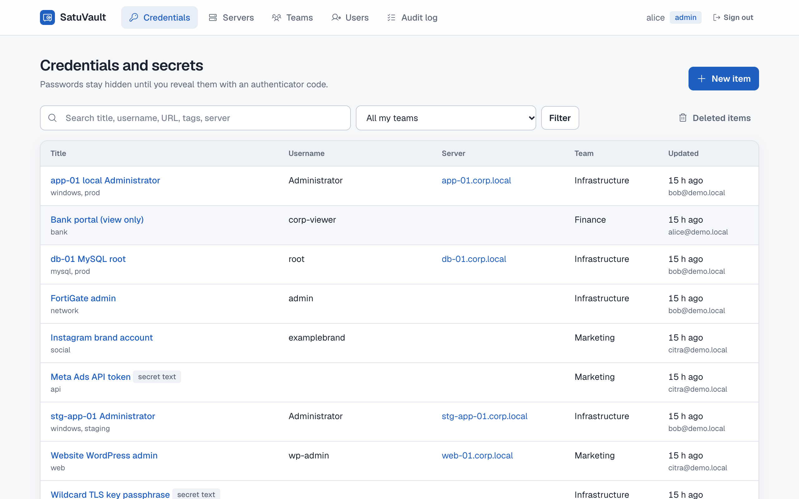
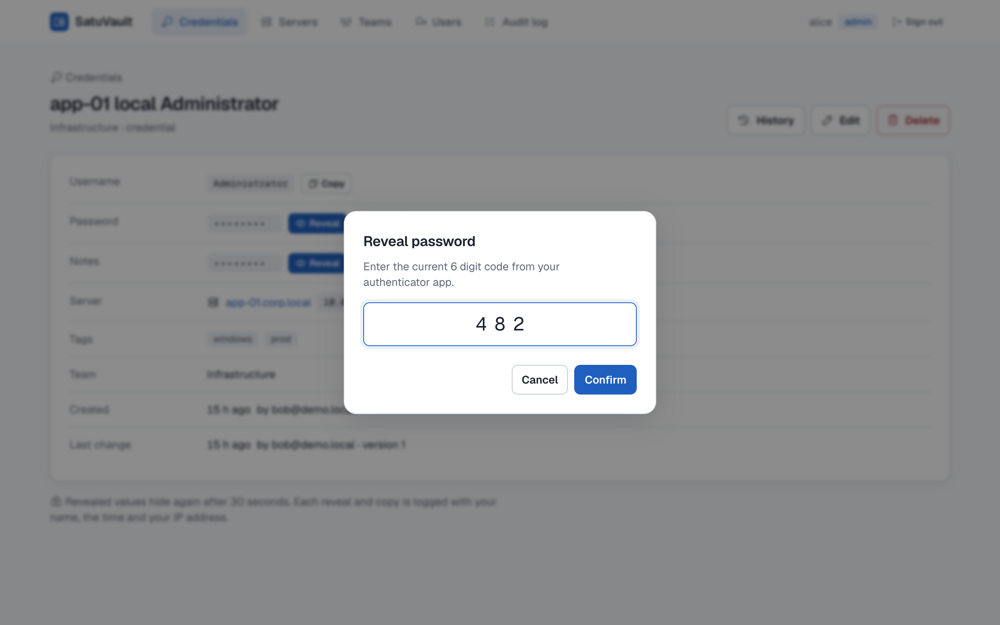
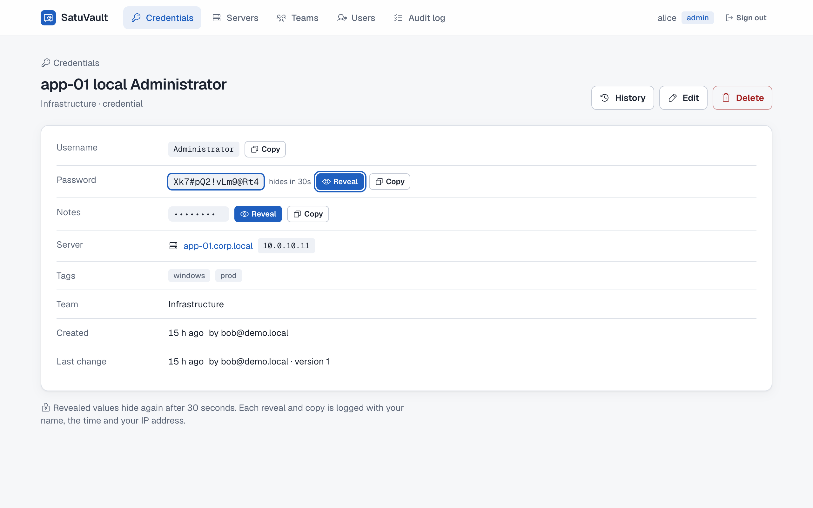
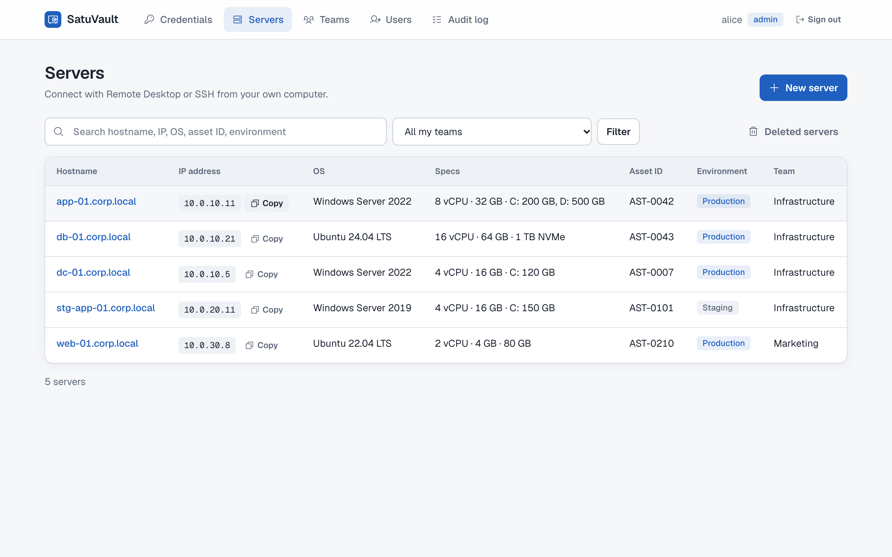
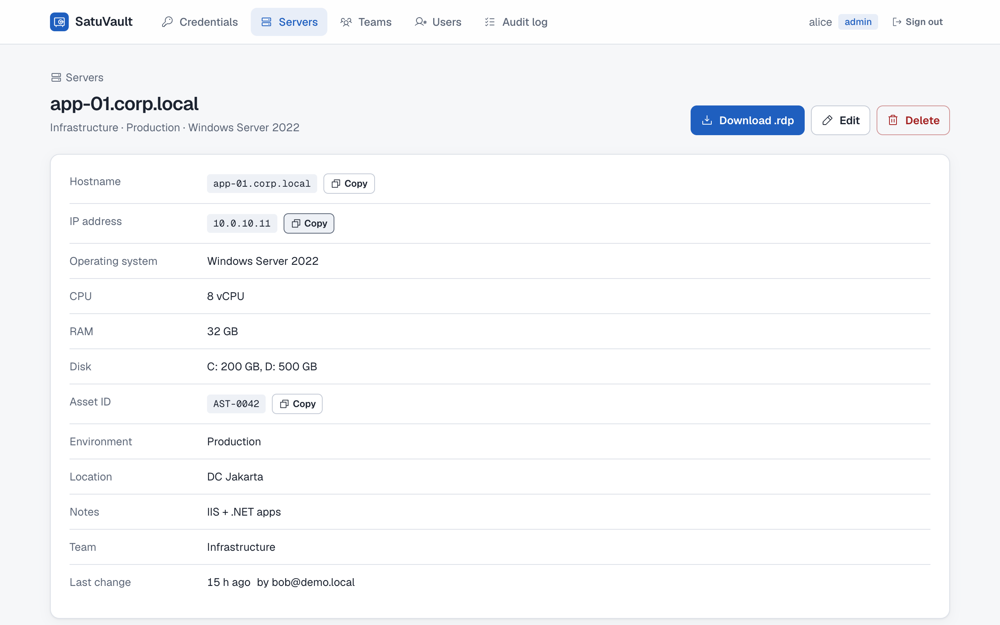
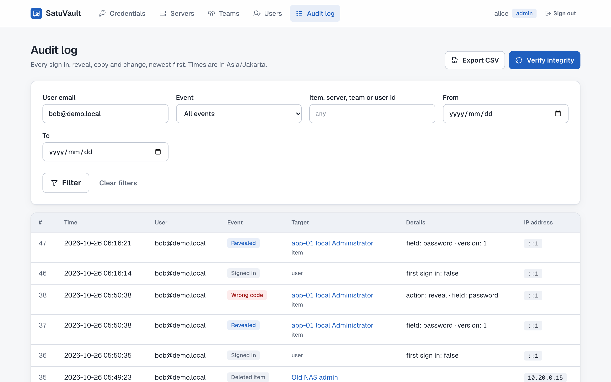
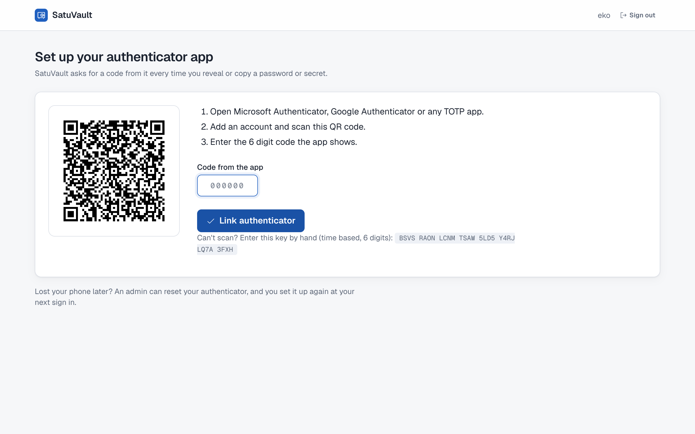

<div align="center">


# SatuVault

**One vault for your team's passwords, secrets and servers.**
No more spreadsheets and notepad files.


<picture>
  <source media="(prefers-color-scheme: dark)" srcset="docs/screenshots/credentials-dark.png">
  
</picture>

[Architecture](docs/ARCHITECTURE.md) · [Install on IIS](docs/DEPLOY-IIS.md) · [Try the demo](#try-the-demo)

</div>

---

## Why SatuVault

|     |     |
| --- | --- |
| 🔐 **Every reveal is a 2FA moment** | Signing in isn't enough. Each reveal or copy of a password or secret asks for a fresh authenticator code, and each code works once. |
| 🧱 **Encrypted before MySQL sees it** | Everything readable is AES-256-GCM encrypted in the app. The master key is DPAPI-protected on the server, so a database dump alone is useless. |
| 📜 **An audit log you can prove** | Append-only and HMAC-chained with a key the database never holds. Filter, verify the chain, export to CSV. |
| 🖥️ **Servers, not just passwords** | Hostname, IP, OS, specs, asset ID and environment, with linked credentials and a password-free `.rdp` download. |
| 👥 **Teams with real boundaries** | Managers and members per team. Items keep a version history, and deleted items can be restored. |
| 🪪 **Microsoft Entra ID sign-in** | Company accounts in, an authenticator app (TOTP) enrolled on first sign-in. The first installer becomes admin with a one-time setup token. |

## A quick tour

<table>
  <tr>
    <td width="50%">
      
      <p align="center"><b>Ask for a code</b><br><sub>Reveal and copy both need the current 6 digit code.</sub></p>
    </td>
    <td width="50%">
      
      <p align="center"><b>Reveal, then hide</b><br><sub>Values hide again after 30 seconds; every reveal is logged.</sub></p>
    </td>
  </tr>
  <tr>
    <td width="50%">
      
      <p align="center"><b>Server inventory</b><br><sub>Search by hostname, IP, OS or asset ID.</sub></p>
    </td>
    <td width="50%">
      
      <p align="center"><b>Server details</b><br><sub>Specs, location, linked credentials and a one-click <code>.rdp</code>.</sub></p>
    </td>
  </tr>
  <tr>
    <td width="50%">
      
      <p align="center"><b>Audit log</b><br><sub>Reveals, wrong codes, deletes: who, when, from where.</sub></p>
    </td>
    <td width="50%">
      
      <p align="center"><b>First sign-in</b><br><sub>Scan the QR code into any TOTP app.</sub></p>
    </td>
  </tr>
</table>

## Try the demo

```sh
demo/run.sh               # MySQL in Docker + seeded demo data → http://localhost:5210/this_platform
demo/run.sh code --watch  # authenticator codes for the seeded users (or: demo/run.sh qr)
demo/run.sh reset         # delete the demo database and keys
```

Needs Docker and the .NET 10 SDK. Sign in on the developer page as:

| Email | Role |
| --- | --- |
| `alice@demo.local` | admin, manager of Finance |
| `bob@demo.local` | manager of Infrastructure |
| `citra@demo.local` | manager of Marketing |
| `dewi@demo.local` | member of Marketing |
| `eko@demo.local` | no team, not enrolled yet (try the authenticator setup) |

Or use any other email. `demo/run.sh --fresh` starts empty and prints the setup token instead, to try
the first-installer flow. The seed tool in `demo/SatuVault.Demo` is not part of the published app.

## Layout

```
src/SatuVault/        the app (Razor Pages) and its CLI: init, migrate, backup-key, restore-key, verify-audit
  Crypto/             key ring (DPAPI), field cipher, blind index, TOTP
  Data/               MySQL repositories + Migrations/*.sql
  Audit/              hash-chained audit log
  Services/           VaultService: permission checks + audit for every change and every reveal
  Pages/              UI
tests/SatuVault.Tests unit, MySQL integration and in-process web tests
```

## Run locally (development)

```sh
docker run -d --name satu-test-mysql -e MYSQL_ROOT_PASSWORD=test -p 53306:3306 mysql:8.4
docker exec satu-test-mysql mysql -uroot -ptest -e "CREATE DATABASE satuvault_dev; CREATE USER 'satuvault_app'@'%' IDENTIFIED BY 'dev-app-pass';"
cd src/SatuVault
export ASPNETCORE_ENVIRONMENT=Development
dotnet run -- migrate --app-user satuvault_app
SATU_BACKUP_PASSPHRASE='dev-backup-passphrase-1234' dotnet run -- init   # prints the setup token
dotnet run                                                               # http://localhost:5209
```

Development uses a developer sign-in page instead of Entra (`SatuVault:DevLogin`, refused
outside Development) and an unprotected key file under `.dev/` (refused in Production).

## Test

```sh
dotnet test        # needs the MySQL container above (or SATU_TEST_MYSQL=<connection string>)
```

<sub>Screenshots are taken from the seeded demo data; every name, host and password in them is fake.</sub>
